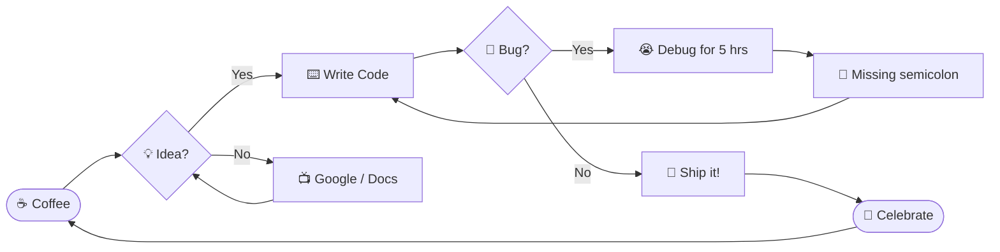

<div align="center">

<!-- ░▒▓█ MEGA ANIMATED HEADER █▓▒░ -->


<!-- TYPING ANIMATION -->
<a href="https://git.io/typing-svg">
  
</a>

<br/>


<p>
  
  
  
  
</p>

<p>
  <a href="https://linkedin.com/in/ahmad-hassan-a05a082a5"></a>
  <a href="https://www.leetcode.com/ft-ahmad_hassan"></a>
  <a href="https://instagram.com/ft.nahmad"></a>
  <a href="https://discord.gg/ft.nahmad"></a>
  <a href="mailto:hranaahmad82@gmail.com"></a>
</p>


</div>

<!-- ═════════════ FAKE TERMINAL ═════════════ -->
<div align="center">

## 💀 `> BOOT SEQUENCE`

</div>

```bash
┌──(ahmad㉿kali)-[~/profile]
└─$ whoami
ahmad_hassan — software engineer, bug hunter, caffeine-powered lifeform

┌──(ahmad㉿kali)-[~/profile]
└─$ cat /proc/brain/status
[ OK ] C++ core ................ LOADED
[ OK ] JavaScript engine ....... LOADED
[ OK ] SQL query optimizer ..... LOADED
[ OK ] Creativity (Figma) ...... LOADED
[WARN] Sleep.................... NOT FOUND
[ OK ] Coffee reserves ......... ∞

┌──(ahmad㉿kali)-[~/profile]
└─$ ./launch_career.sh --mode=beast --no-limits
🚀 Launching... 3... 2... 1... 💥
```


<!-- ═════════════ WHO AM I ═════════════ -->
<div align="center">

## 🧬 `< WHO AM I? />`


</div>

```javascript
╔══════════════════════════════════════════════════════════════════╗
║   const AHMAD_HASSAN = {                                         ║
║     📍 location   : "Pakistan 🇵🇰",                              ║
║     🎓 role        : "Software Engineer",                        ║
║     💻 stack       : ["C++", "JS", "HTML", "CSS", "SQL"],        ║
║     🧠 superpower  : "Complex problems → clean code",            ║
║     ⚡ currently   : "Building cool stuff & grinding LeetCode",  ║
║     ☕ fuel        : "Coffee × ∞",                               ║
║     🎯 goal        : "Ship code that matters",                   ║
║     🌱 learning    : "Always. Every. Single. Day.",              ║
║     🤝 open_to     : "Collabs, freelance & open-source",         ║
║     🔥 fun_fact    : "I debug in my dreams",                     ║
║   }                                                              ║
╚══════════════════════════════════════════════════════════════════╝
```


<!-- ═════════════ RPG CHARACTER SHEET ═════════════ -->
<div align="center">

## 🎮 `PLAYER 1 — CHARACTER SHEET`

| 🧙 CLASS | ⚔️ Full-Stack Warrior-Mage |
|:--|:--|
| 🏰 GUILD | Open-Source Alliance |
| 🎖️ LEVEL | `LVL 99+` (and rising) |
| ❤️ HP | `Caffeine-regenerating` |
| 🔮 MANA | `∞ (while Wi-Fi > 0)` |
| 🗡️ WEAPON | `Keyboard of Infinite Refactoring` |
| 🛡️ ARMOR | `Hoodie of +10 Focus` |
| 🐉 BOSS DEFEATED | `Segmentation Fault, Null Pointer, CSS Centering` |
| 💥 ULTIMATE | `"It works on my machine"` |

**STR** `█████████░` &nbsp; **INT** `██████████` &nbsp; **DEX** `████████░░` &nbsp; **LUK** `███████░░░` &nbsp; **CHA** `█████████░`

</div>


<!-- ═════════════ SNAKE ═════════════ -->
<div align="center">

## 🐍 `THE CONTRIBUTION SNAKE IS HUNGRY`

<picture>
  <source media="(prefers-color-scheme: dark)" srcset="https://raw.githubusercontent.com/platane/platane/output/github-contribution-grid-snake-dark.svg"/>
  <source media="(prefers-color-scheme: light)" srcset="https://raw.githubusercontent.com/platane/platane/output/github-contribution-grid-snake.svg"/>
  
</picture>

> 🍎 *Feed it commits. It never stops eating.*

</div>

<!-- ═════════════ TECH ARSENAL ═════════════ -->
<div align="center">

## ⚡ `TECH ARSENAL` ⚡


### 🖥️ Languages


### 🛠️ Tools & Platforms


### 🗄️ Databases


<br/>


</div>


<!-- ═════════════ SKILL BARS ═════════════ -->
<div align="center">

## 🎯 `SKILL LEVEL UNLOCKED`

</div>

```
⚡ C / C++            ██████████████████░░ 90%  [👑 MASTER]
🌐 HTML / CSS         ███████████████████░ 92%  [🔥 EXPERT]
⚙️  JavaScript         ████████████████░░░░ 80%  [💪 ADVANCED]
🗄️  SQL (MySQL/MSSQL)  ███████████████░░░░░ 78%  [💪 ADVANCED]
🎨 Figma / UI-UX      ██████████████░░░░░░ 72%  [✨ PROFICIENT]
🔧 Git / GitHub       ██████████████████░░ 88%  [🔥 EXPERT]
🖥️  Qt Framework       █████████████░░░░░░░ 68%  [✨ PROFICIENT]
📊 MATLAB             ████████████░░░░░░░░ 60%  [🌱 INTERMEDIATE]
☕ Coffee Tolerance    ████████████████████ ∞%   [☠️ LEGENDARY]
```

<!-- ═════════════ MERMAID ═════════════ -->
<div align="center">

## 🧠 `HOW MY BRAIN WORKS`

</div>




<!-- ═════════════ STATS ═════════════ -->
<div align="center">

## 📊 `GITHUB STATS DASHBOARD`

<table>
  <tr>
    <td>
      
    </td>
    <td>
      
    </td>
  </tr>
</table>


## 📈 `CONTRIBUTION ACTIVITY`

[](https://github.com/ashutosh00710/github-readme-activity-graph)

</div>


<!-- ═════════════ TROPHIES ═════════════ -->
<div align="center">

## 🏆 `TROPHY CABINET`

[](https://github.com/ryo-ma/github-profile-trophy)

## ⚔️ `LEETCODE BATTLEGROUND`

[](https://leetcode.com/ft-ahmad_hassan)

</div>

<!-- ═════════════ ACHIEVEMENTS ═════════════ -->
<div align="center">

## 🏅 `ACHIEVEMENTS UNLOCKED`

| 🎖️ Achievement | 📜 Description | Status |
|:--|:--|:--:|
| 🐛 **Bug Exterminator** | Fixed a bug by deleting the whole file | ✅ |
| 🌙 **Night Owl** | Pushed code at 3:47 AM | ✅ |
| ☕ **Caffeine Overlord** | Drank coffee so strong the IDE got jitters | ✅ |
| 🧩 **LeetCode Warrior** | Solved hundreds of problems | ✅ |
| 🔁 **Infinite Loop Survivor** | Escaped `while(true)` unharmed | ✅ |
| 📚 **Eternal Student** | Learns something new daily | ✅ |
| 🤝 **Team Player** | Reviewed a PR without rage-quitting | ✅ |
| 🚀 **Ship It!** | Deployed on a Friday and lived | 🔒 *(too dangerous)* |
| 👑 **Legendary Dev** | ... | ⏳ *Loading 87%* |

</div>


<!-- ═════════════ DEV HUMOR ═════════════ -->
<div align="center">

## 😂 `DEVELOPER HUMOR ZONE`


[](https://github.com/piyushsuthar/github-readme-quotes)

</div>

```cpp
// 🧠 The 5 Stages of Debugging
#include <iostream>
int main() {
    std::cout << "1. That can't happen.\n";
    std::cout << "2. That doesn't happen on my machine.\n";
    std::cout << "3. That shouldn't happen.\n";
    std::cout << "4. Why does that happen?\n";
    std::cout << "5. Oh... that's why. 🤦\n";
    return 0; // 🎉 *pretends everything is fine*
}
```


<!-- ═════════════ 3D + HEATMAP ═════════════ -->
<div align="center">

## 🌐 `3D CONTRIBUTION CITY`

[](https://github.com/yoshi389111/github-profile-3d-contrib)

> ⬆️ *Every commit builds a skyscraper in my code-city.* 🏙️

## 🔥 `COMMIT HEATMAP`

[](https://github.com/ahmadhassanse)

## ⏱️ `WAKATIME CODING STATS`

[](https://wakatime.com/@ahmadhassanse)

</div>

<!-- ═════════════ ROADMAP ═════════════ -->
<div align="center">

## 🗺️ `QUEST LOG / ROADMAP`

</div>

- [x] 🌱 Learn the fundamentals (C / C++)
- [x] 🌐 Conquer the web (HTML, CSS, JS)
- [x] 🗄️ Master databases (MySQL, SQLite, MSSQL)
- [x] 🎨 Design like a pro (Figma)
- [ ] ⚔️ Hit 500+ LeetCode problems
- [ ] 🚀 Ship a massive open-source project
- [ ] 🧠 Dive deep into AI / ML
- [ ] ☁️ Conquer the cloud (AWS / Docker / K8s)
- [ ] 👑 Become a legendary engineer

<!-- ═════════════ COLLAPSIBLE EASTER EGGS ═════════════ -->
<details>
<summary><b>🥚 CLICK ME — SECRET EASTER EGG #1</b></summary>
<br/>

```
   ∧,,,∧
  ( ̳• · • ̳)   You found the secret cat!
  /    づ♡    It says: "git commit -m 'fix' — never 'fix fix fix final FINAL v2'"
```
</details>

<details>
<summary><b>🔓 CLICK ME — HACKER MODE</b></summary>
<br/>

```
01001000 01100101 01101100 01101100 01101111
01010111 01101111 01110010 01101100 01100100
>>> ACCESS GRANTED. Welcome, fellow nerd. 🤓
```
</details>

<details>
<summary><b>🤯 CLICK ME — DO NOT CLICK</b></summary>
<br/>


*You've been rickrolled by a README. Respect the hustle.* 😎
</details>


<!-- ═════════════ METRICS ═════════════ -->
<div align="center">

## 📟 `DEVELOPER METRICS`

| 🧩 Metric | 📊 Value |
|:--|:--|
| ☕ Coffee Consumed | `∞ cups` |
| 🐛 Bugs Fixed | `999+` |
| 🐛 Bugs Created | `1000+` |
| 💡 "Aha!" Moments | `Daily` |
| 🌙 Late-Night Sessions | `Too many to count` |
| 🔥 LeetCode Streak | `Growing 📈` |
| 🎯 Problems Solved | `Hundreds` |
| 🖱️ Stack Overflow Visits | `Yes.` |
| 💻 Lines of Code | `Counting...` |

</div>

<!-- ═════════════ SOCIAL ═════════════ -->
<div align="center">

## 🌐 `FIND ME ON THE INTERNET`

<a href="https://linkedin.com/in/ahmad-hassan-a05a082a5"></a>
<a href="https://www.leetcode.com/ft-ahmad_hassan"></a>
<a href="https://instagram.com/ft.nahmad"></a>
<a href="https://discord.gg/ft.nahmad"></a>
<a href="mailto:hranaahmad82@gmail.com"></a>

<br/><br/>


</div>

<!-- ═════════════ FOOTER ═════════════ -->
<div align="center">

### ⚡ `"First, solve the problem. Then, write the code."` — John Johnson

<br/>

[](https://profile-summary-for-github.com/user/ahmadhassanse)

<br/>


**⭐ Thanks for visiting! Leave a star on something you like — it fuels the coffee machine! ☕🙏**

```
   ┌─────────────────────────────────────────┐
   │  while (alive) { eat(); sleep(); code(); }  │
   │  // sleep() is optional                  │
   └─────────────────────────────────────────┘
```


</div>
